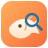

# dsh-free-xianyu · 闲鱼免费监控 for DeepSeek Harness
关领到免费token不知道拿来做什么，做开发又怕不安全，额度不够，对话又有点多余，不如做些实际的功能，又不会又风险的事情把
把闲鱼（Goofish）二手商品监控做成 **DeepSeek Harness 插件**：装进 Harness 后，左侧导航多一个
「闲鱼免费监控」，点开就能起服务、建任务、跑抓取、看 AI 选品结果；AI 分析走 **dsh-our-free-model**
的免费模型，不需要自己的付费 API Key。

> 这个仓库只是**插件本身**（Host 半身 + 浏览器半身）。真正的抓取、AI 分析、Web 控制台都在
> [ai-goofish-monitor](https://github.com/Usagi-org/ai-goofish-monitor) 里，本插件负责安装它、
> 托管它的进程、把它的 AI 接到免费模型网关上。

<p align="center">
  
</p>

## 它做了什么

```
DeepSeek Harness Host 进程
└─ dsh-free-xianyu
   ├─ Host 半身 (index.js + lib/)
   │  ├─ 托管子进程: python -m src.app      → http://127.0.0.1:8848
   │  ├─ 12 个 goofish_* Agent 工具
   │  ├─ 同源 API: /api/dsh-free-xianyu/*
   │  └─ 前端构建桥: 自动 npm install + npm run build
   └─ 浏览器半身 (client.js)
      ├─ sidebar.panellist → 左侧导航「闲鱼免费监控」图标
      └─ main             → 监控面板（状态/任务/结果/日志/AI 模型）

AI 调用链
└─ ai-goofish-monitor 的 .env
   OPENAI_BASE_URL=http://127.0.0.1:<网关端口>/v1
   OPENAI_API_KEY=<网关 Key>
   OPENAI_MODEL_NAME=<免费视觉模型>
   ↑ 由 dsh-our-free-model 的本地网关提供
```

### 特性

- **一站式生命周期**：装好插件自动起后台；停止/重启/健康检查/退出清理都由插件负责。已经在跑的实例会被
  复用（不会去杀不是它启动的进程）。
- **前端自动构建**：ai-goofish-monitor 的后端只在启动时 `dist/` 已存在才挂载 `/assets`，所以插件把
  「装依赖 → 构建 → 再起后台」串成一步，`http://127.0.0.1:8848/` 开箱即是完整 Vue 控制台。
- **12 个 Agent 工具**：模型可以直接建任务、跑任务、读结果、看日志、切模型、构建前端。
- **免费模型接入**：自动发现 dsh-our-free-model 的本地网关（`chanGateway.relay` 或 `forward`），
  挑选带视觉能力的免费模型，写进项目 `.env`（备份为 `.env.bak`）。
- **侧边栏面板**：不离开 Harness 就能看服务状态、任务列表、结果文件、日志与 AI 配置。

## 依赖的上游项目

| 项目 | 作用 | 链接 |
| --- | --- | --- |
| **ai-goofish-monitor** | FastAPI 后端 + Playwright 抓取 + Vue 控制台，本插件托管的核心 | <https://github.com/Usagi-org/ai-goofish-monitor> |
| **dsh-our-free-model** | 本地 OpenAI 兼容网关，提供免费模型车道 | <https://github.com/Ebony-Vinyl/dsh-our-free-model> |

这两个项目各自独立维护，本仓库不包含它们的源码。请分别遵守它们的许可证（均为 MIT / 各自仓库声明）。

## 安装

### 1. 先装两个上游

```bash
# ai-goofish-monitor：克隆到任意目录
git clone https://github.com/Usagi-org/ai-goofish-monitor.git
cd ai-goofish-monitor
python -m pip install -r requirements.txt
python -m playwright install chromium

# 在 Harness 里装免费模型插件（设置 → 插件 → 插件市场，或）
#   dsh-our-free-model: https://github.com/Ebony-Vinyl/dsh-our-free-model
```

### 2. 装本插件

```text
plugin_manager action=install_bundle target=<本仓库目录>
```

或在 Harness 设置 → 插件 → 从本地目录安装。安装后 `cordis.patch.yml` 会插入一行
`dsh-free-xianyu`，默认 `projectRoot` 为空表示「本仓库的上一级」，所以推荐这样放：

```
<某个目录>/
├── ai-goofish-monitor/     ← 上游项目
└── dsh-free-xianyu/        ← 本仓库
```

如果目录结构不同，在 profile 的 `cordis.patch.yml` 里把 `projectRoot` 指到 ai-goofish-monitor
的绝对路径即可。

### 3. 确认

让 Agent 调用（或直接看侧边栏面板）：

```text
goofish_status                    # 服务/AI/项目状态
goofish_console action=status     # 控制台构建状态
```

## 配置

在 profile 的 `cordis.patch.yml` 里覆盖该行的 `config`：

| 字段 | 默认 | 说明 |
| --- | --- | --- |
| `projectRoot` | 空 | ai-goofish-monitor 目录；空 = 本仓库的上一级 |
| `pythonPath` | `python` | Python 解释器（可写绝对路径） |
| `serverPort` | `8848` | 后台监听端口（仅本机） |
| `autoStart` | `true` | 插件激活时自动启后台 |
| `aiBaseURL` | 空 | 手动指定 OpenAI 兼容地址；空 = 自动用免费模型网关 |
| `aiApiKey` | 空 | 手动指定网关 Key；空 = 自动读 |
| `aiModel` | 空 | 固定模型 id；空 = 自动选带视觉的免费模型 |
| `requestTimeoutMs` | `15000` | 调用后台接口超时 |
| `manageEnv` | `true` | 是否把 AI 设置写入项目 `.env` |
| `buildFrontend` | `true` | 是否管理前端构建（关掉则完全不碰 `web-ui/`、`dist/`） |
| `autoBuildFrontend` | `true` | 启后台前自动补齐/重建 `dist/` |
| `frontendInstall` | `true` | 缺 `web-ui/node_modules` 时自动 `npm install` |

## Agent 工具

| 工具 | 作用 |
| --- | --- |
| `goofish_status` | 服务、AI、项目、控制台状态 |
| `goofish_server` | 启动 / 停止 / 重启后台 |
| `goofish_console` | 控制台构建状态 / 触发构建（可顺带重启） |
| `goofish_tasks` | 任务列表 |
| `goofish_task_create` | 建任务（AI 判断或关键词判断） |
| `goofish_task_update` / `goofish_task_delete` | 改 / 删任务（任务需启用后才能跑） |
| `goofish_task_run` / `goofish_task_stop` | 运行 / 停止任务 |
| `goofish_results` | 结果文件列表 / 商品分析预览 |
| `goofish_logs` | 任务日志尾部 |
| `goofish_ai` | AI 网关状态 / 模型列表 / 应用模型 |

调试抓取条数不是工具参数，而是后台环境变量 `SPIDER_DEBUG_LIMIT`（由 ai-goofish-monitor 的
`src/services/process_service.py` 读取），要在启动后台前设置。

## 接入免费模型的步骤

1. 在 Harness 里装好 `dsh-our-free-model`。
2. 打开 **设置 → Our Free Model → 网关设置**，开启网关（渠道模型网关 / 中继）。
   插件会按顺序探测该插件声明的两个 OpenAI 兼容监听器：先 `chanGateway.relay`（页面上的
   「启用网关」），再旧版 `forward` 监听（默认 18899）。任一开启即可。
3. `goofish_ai action=models` 看可用模型，`goofish_ai action=apply model=<id>` 应用。
   推荐带视觉的免费模型，例如 `our-free-model/nemotron-3.5-super-vl-free`。
4. 插件把三项写进 ai-goofish-monitor 的 `.env` 并重启后台：

   ```dotenv
   OPENAI_BASE_URL=http://127.0.0.1:<网关端口>/v1
   OPENAI_API_KEY=<网关 Key>
   OPENAI_MODEL_NAME=our-free-model/nemotron-3.5-super-vl-free
   ```

> **免费车道的额外前置**：`our-free-model/*-free` 系列由 dsh-our-free-model 通过本机 **Bun**
> 转发。没装 Bun 会返回 502 并提示「需要本机 Bun」：`npm i -g --allow-scripts=bun bun`。
> 非免费车道模型（如 `cline/nvidia/nemotron-3.5-super-vl`）不需要 Bun。

## 使用方式

- **侧边栏面板**：左侧「闲鱼免费监控」→ 服务状态与启停、完整控制台入口、AI 模型下拉、任务列表
  （运行/停止/看日志）、结果文件。每 5 秒自动刷新。
- **完整 Vue 控制台**：`http://127.0.0.1:8848/`（端口取 `serverPort`）。任务、结果、日志、设置都在
  这里；由 ai-goofish-monitor 提供，插件负责构建与托管。
- **对话里**：直接说「建一个监控 MacBook Air M1、2500-3500 的任务并跑一次」，模型会调用对应工具。

## 前置条件

- **Python 3.10+**，并已安装 ai-goofish-monitor 的依赖：`pip install -r requirements.txt`
  （本插件不替你 pip install）。
- **Node.js + npm**（构建前端用）。首次启动缺依赖时插件会自动 `npm install`。
- **Playwright 浏览器**：`python -m playwright install chromium`。
- **闲鱼登录态**：通过 ai-goofish-monitor 的 Web UI 更新 `state.json`。
  没有登录态时任务会在 `goofish_logs` 里报错，这是上游项目的前置条件，不是插件故障。
- 商品分析默认读图片，必须用**支持视觉**的模型。

## 安全说明

- 后台服务只绑定本机回环；插件的 API 走 Harness 同源路由，并用与 Harness `/api` 相同的准入校验
  （`connection.requestRejection`），不额外暴露到局域网。
- 网关 Key 只写进本机 `.env`，插件的状态接口只返回掩码。
- 本插件**不修改** dsh-our-free-model 的设置；开启网关要你在它自己的设置页操作。
- `.env` 在 ai-goofish-monitor 里是运行配置（通常已被 gitignore）；插件写入前会生成 `.env.bak`。

## 开发与自测

```bash
# 语法检查
node --check index.js
node --check client.js
node --check lib/*.js

# 纯逻辑自测（不需要真实网关 / 后台）
node client.selftest.mjs              # 浏览器半身：插槽注册契约
node lib/frontend.selftest.mjs        # 前端构建状态判定
node lib/gateway.selftest.mjs         # 免费模型网关发现与环境写入
node lib/goofish-api.selftest.mjs     # HTTP 客户端；设 GOOFISH_TEST_BASEURL 时跑真实接口
```

浏览器半身只做两件事：注册 `sidebar.panellist`（图标）和 `main`（面板），写法与
`dsh-context`、`dshmarket` 一致；`apply()` 全同步、所有注册都包在 try/catch 里，页面请求失败只显示在
面板内，不会阻塞 Harness 的 `web boot`。

## 许可证

[MIT](LICENSE) © 2026 Fouxiuan

本仓库不包含上游项目的源码，只是运行时调用它们。第三方声明与各自的许可证见
[NOTICE.md](NOTICE.md)：ai-goofish-monitor 为 MIT（Copyright (c) 2025 dingyufei615），
dsh-our-free-model 见其仓库声明。
